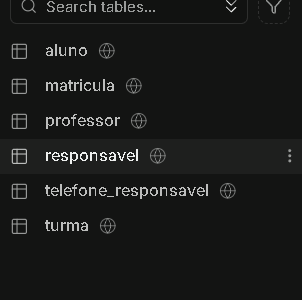

# Arena Jovem Futebol
**Sistema de Gestão de uma Escolinha de Futebol**

## 1. Cenário

### 1.1 Descrição da empresa

A Arena Jovem Futebol é uma escolinha fictícia de futebol localizada na cidade de Franca, no estado de São Paulo. A empresa oferece treinamentos esportivos para crianças e adolescentes, buscando desenvolver habilidades técnicas, físicas e sociais por meio da prática do futebol.

A escolinha possui uma única unidade e conta com professores responsáveis pelos treinamentos, além de turmas organizadas para os alunos.

### 1.2 Problema ou necessidade

Atualmente, a administração da Arena Jovem Futebol enfrenta dificuldades para organizar as informações dos alunos, responsáveis, professores, turmas e matrículas.

O controle dessas informações é realizado manualmente, por meio de planilhas e anotações, o que pode ocasionar perda de dados, informações duplicadas e dificuldades na consulta de registros.

Diante dessa situação, surgiu a necessidade de desenvolver um banco de dados capaz de centralizar e organizar as informações da escolinha, facilitando o controle administrativo.

### 1.3 Objetivo do sistema

O objetivo do projeto é desenvolver um banco de dados relacional para a Arena Jovem Futebol, utilizando PostgreSQL por meio da plataforma Supabase.

O sistema deverá permitir o cadastro e a consulta de alunos, responsáveis, professores, turmas e matrículas, facilitando a organização dos treinamentos e o acompanhamento das inscrições dos alunos.

### 1.4 Entidades identificadas

Para atender às necessidades da empresa, foram identificadas cinco entidades:

- **Aluno:** armazena os dados pessoais dos alunos da escolinha.
- **Responsável:** contém as informações dos responsáveis pelos alunos.
- **Professor:** armazena os dados dos profissionais responsáveis pelos treinamentos.
- **Turma:** organiza os alunos em grupos de treinamento, de acordo com categorias e horários.
- **Matrícula:** registra a inscrição de um aluno em uma turma.

### 1.5 Relacionamentos identificados

As entidades possuem relacionamentos que representam o funcionamento da escolinha:

- Um responsável pode estar associado a vários alunos.
- Um aluno pode possuir várias matrículas ao longo do tempo.
- Cada professor pode ser responsável por apenas uma turma.
- Cada turma possui apenas um professor responsável.
- Uma turma pode possuir várias matrículas.
- A entidade Matrícula faz a ligação entre Aluno e Turma, representando o relacionamento muitos para muitos (N:N) entre essas entidades.

## 2. Modelagem Conceitual

A modelagem conceitual da Arena Jovem Futebol foi desenvolvida por meio de um Diagrama Entidade-Relacionamento (DER), representando as principais informações e os relacionamentos necessários para o funcionamento da escola de futebol.

O modelo possui cinco entidades principais:

- **Aluno:** armazena os dados dos alunos cadastrados na escola.
- **Responsável:** contém os dados dos responsáveis pelos alunos.
- **Professor:** armazena as informações dos professores.
- **Turma:** representa as turmas disponíveis na escola.
- **Matrícula:** registra a matrícula dos alunos nas turmas.

### Relacionamentos

- **Responsável e Aluno (1:N):** um responsável pode estar associado a vários alunos, mas cada aluno possui um responsável cadastrado.
- **Professor e Turma (1:1):** cada professor é responsável por uma única turma, e cada turma possui um único professor.
- **Aluno e Matrícula (1:N):** um aluno pode possuir várias matrículas ao longo do tempo, mas cada matrícula pertence a um único aluno.
- **Turma e Matrícula (1:N):** uma turma pode possuir várias matrículas, mas cada matrícula pertence a uma única turma.

A entidade Matrícula funciona como uma entidade associativa, permitindo representar o relacionamento muitos para muitos (N:N) entre Aluno e Turma.

### Tipos de atributos utilizados

- **Simples:** nome, CPF e data de nascimento.
- **Composto:** endereço, dividido em rua, número, bairro e CEP.
- **Multivalorado:** telefone do responsável, que pode possuir mais de um número.
- **Derivado:** idade do aluno, calculada a partir da data de nascimento.
- **Identificador:** IDs utilizados como chaves primárias das entidades.
- 

## 3. Modelagem Lógica

A modelagem lógica transforma o Diagrama Entidade-Relacionamento em tabelas, definindo seus atributos, tipos de dados, chaves primárias (PK) e chaves estrangeiras (FK).

O banco de dados foi estruturado em cinco tabelas principais e uma tabela auxiliar, utilizando tipos de dados compatíveis com PostgreSQL.

### Observações

- **PK (Primary Key):** identifica cada registro de forma única.
- **FK (Foreign Key):** estabelece a ligação entre as tabelas.
- O atributo idade não foi incluído como coluna, pois é derivado da data de nascimento.
- A tabela Telefone_Responsavel foi criada para permitir que um responsável tenha vários números de telefone.
- 

## 4. Modelagem Física

A modelagem física do projeto Arena Jovem Futebol foi implementada utilizando o **Supabase**, com o sistema de gerenciamento de banco de dados PostgreSQL.

Foram criadas seis tabelas para organizar as informações dos alunos, responsáveis, professores, turmas, matrículas e telefones dos responsáveis.

### 4.1 Criação das tabelas

As tabelas foram criadas por meio de comandos SQL utilizando `CREATE TABLE` no SQL Editor do Supabase.

As tabelas implementadas foram:

- **aluno:** armazena os dados dos alunos.
- **responsavel:** armazena os dados dos responsáveis.
- **professor:** armazena os dados dos professores.
- **turma:** armazena as informações das turmas.
- **matricula:** registra as matrículas dos alunos nas turmas.
- **telefone_responsavel:** permite armazenar os telefones dos responsáveis.

A imagem abaixo demonstra as tabelas criadas no Supabase.

### 4.2 Comandos SQL de criação

A criação das tabelas foi realizada por meio de comandos `CREATE TABLE`, definindo os campos, os tipos de dados, as chaves primárias e as chaves estrangeiras.

As capturas de tela abaixo demonstram os comandos utilizados no SQL Editor do Supabase.

**Criação das tabelas:**

### 4.3 Chaves e restrições

Foram utilizadas chaves primárias (PK) para identificar cada registro de forma única e chaves estrangeiras (FK) para estabelecer os relacionamentos entre as tabelas.

Também foi utilizada a restrição `UNIQUE` no campo `id_professor` da tabela `turma`, garantindo que um mesmo professor não seja associado a mais de uma turma.

### 4.4 Relacionamentos e integridade referencial

Os relacionamentos foram implementados por meio de chaves estrangeiras:

- **Responsável e Aluno:** relacionamento 1:N.
- **Professor e Turma:** relacionamento 1:1.
- **Aluno e Matrícula:** relacionamento 1:N.
- **Turma e Matrícula:** relacionamento 1:N.
- **Responsável e Telefone_Responsavel:** relacionamento 1:N.

A integridade referencial foi configurada por meio das chaves estrangeiras, garantindo que os registros relacionados estejam vinculados corretamente.

Foram realizadas consultas utilizando `JOIN` para verificar o funcionamento dos relacionamentos entre as tabelas.

### 4.5 Scripts SQL

Os comandos utilizados na implementação do banco de dados estão disponíveis na pasta `sql` deste repositório.

- [01_criacao_tabelas.sql](sql/01_criacao_tabelas.sql) — comandos de criação das tabelas.
- [02_dados_teste.sql](sql/02_dados_teste.sql) — inserção dos dados utilizados nos testes.
- [03_consultas_teste.sql](sql/03_consultas_teste.sql) — consultas utilizadas para verificar os relacionamentos.

## 5. Dados

Após a criação das tabelas no Supabase, foi realizada a inserção de dados para popular o banco de dados da Arena Jovem Futebol.

Foram inseridos **500 registros em cada uma das seis tabelas**, totalizando **3.000 registros**.

### 5.1 Inserção dos dados

Os dados foram inseridos utilizando comandos SQL com `INSERT INTO` e `SELECT`, juntamente com a função `generate_series`, permitindo gerar vários registros de forma automática.

As tabelas receberam os seguintes dados:

- **aluno:** 500 registros de alunos.
- **responsavel:** 500 registros de responsáveis.
- **professor:** 500 registros de professores.
- **turma:** 500 registros de turmas.
- **matricula:** 500 registros de matrículas.
- **telefone_responsavel:** 500 registros de telefones.

### 5.2 Conferência dos registros

Após a inserção, foram realizadas consultas utilizando `COUNT(*)` para verificar a quantidade de registros em cada tabela.

O resultado confirmou que todas as seis tabelas possuem 500 registros, totalizando 3.000 registros no banco de dados.

### 5.3 Script SQL

O script utilizado para inserir os registros está disponível no repositório:

- [04_insercao_500_registros.sql](sql/04_insercao_500_registros.sql) — comandos responsáveis pela inserção dos registros nas seis tabelas.

## 6. CRUD - Create, Read, Update e Delete

Foram realizadas as quatro operações básicas de manipulação de dados (CRUD) no Supabase, utilizando comandos SQL.

### 6.1 Create (Inserção)

Foi realizado o cadastro de um novo aluno na tabela `aluno`, utilizando o comando `INSERT INTO`.

### 6.2 Read (Consulta)

Foi realizada uma consulta para localizar o aluno cadastrado, utilizando o comando `SELECT`.

### 6.3 Update (Atualização)

Foi realizada a atualização do bairro do aluno Pedro Santos, utilizando o comando `UPDATE`.

### 6.4 Delete (Exclusão)

Foi realizada a exclusão do aluno de teste Pedro Santos, utilizando o comando `DELETE`. Em seguida, uma consulta confirmou que o registro não estava mais presente na tabela.

## 7. Relatórios

Relatório 1 — Alunos com matrícula ativa
Objetivo: visualizar os alunos que estão frequentando as aulas, mostrando também o nome de seus responsáveis e a categoria da turma.
